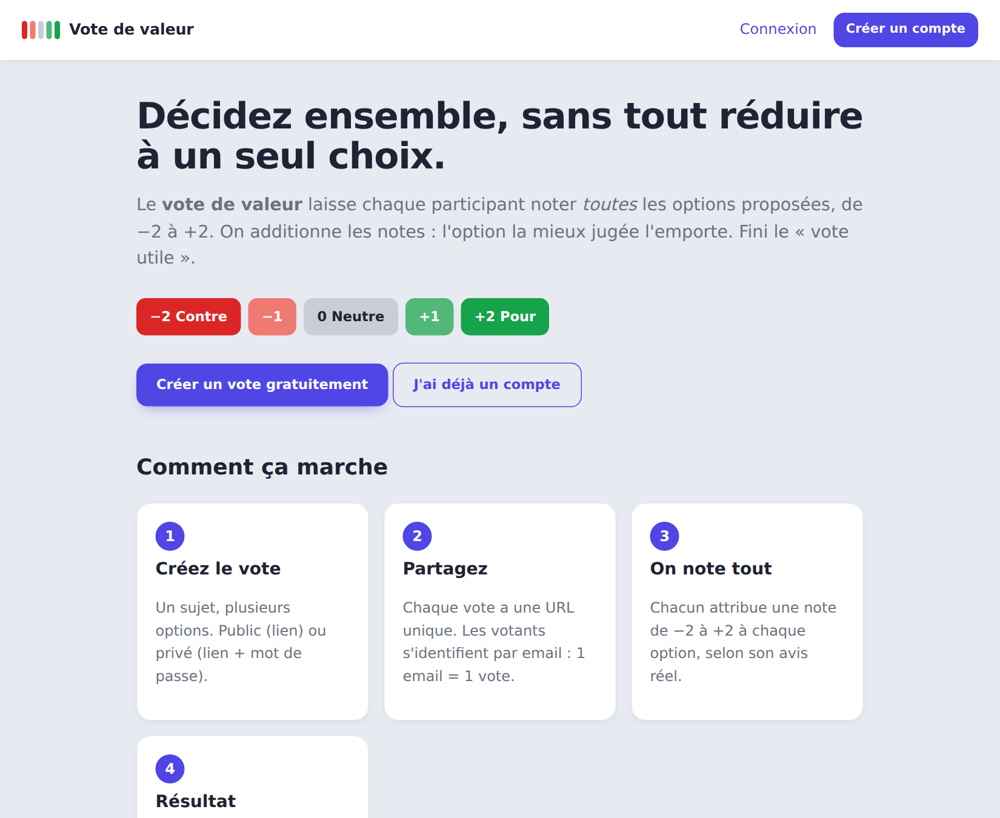
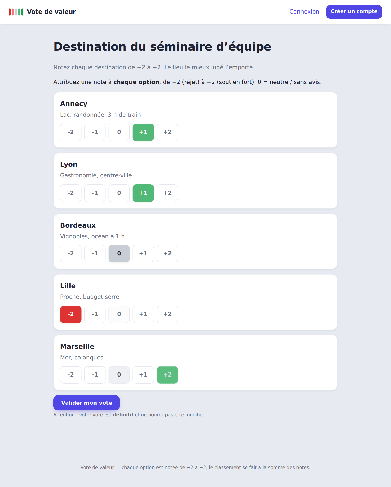

# Vote de valeur

[](https://github.com/vlebourl/vote-de-valeur/actions/workflows/ci.yml)
[](LICENSE)

*[English version](README.md)*

Application web pour organiser des **votes de valeur** : chaque votant note **chaque** option de **−2 à +2**, et le classement se fait à la **somme des notes**. Au lieu de choisir un seul favori, chacun exprime un avis nuancé sur chaque option, ce qui supprime le « vote utile ».

| Accueil | Bulletin | Résultats en direct |
|---|---|---|
|  |  |  |

## Fonctionnalités

- **Organisateurs** : compte (email + mot de passe), puis scrutins avec options texte et/ou image, description, date de clôture facultative. Titre, description et options restent modifiables après l'ouverture.
- **Trois façons d'identifier les votants**, au choix pour chaque scrutin :
  - **lien magique par email** (par défaut) : un email = un vote, sans compte ;
  - **par nom** (mode léger, pour les groupes de confiance) : un nom = un vote ;
  - et tout scrutin peut être **privé** (lien + mot de passe).
- **Vote secret ou nominatif** : par défaut, personne, pas même l'organisateur, ne peut relier un bulletin à un votant. Un scrutin peut passer en nominatif ; les votants en sont alors avertis sur le bulletin.
- **Résultats** invisibles avant d'avoir voté (pas d'influence), puis affichés **en direct** via un lien personnel permanent, aussi envoyé dans l'email de confirmation (qui ne rappelle que ses propres notes, jamais les résultats).
- **Seuil de publication** : les résultats restent masqués, pour les votants comme pour l'organisateur, tant que le scrutin n'a pas atteint un nombre minimal de bulletins (5 par défaut) : avec un ou deux bulletins, les totaux révéleraient les votes.
- **Classement** : somme des notes, abstention = 0, ex æquo au même rang (méthode « 1224 »).
- **API REST** pour les organisateurs (jetons, documentation OpenAPI) : voir plus bas.

## Le secret du bulletin

En scrutin secret, la base ne contient rien qui relie un votant à son bulletin :

- l'email (ou le nom) du votant n'est stocké que sous forme de **HMAC**, qui garantit un seul vote par personne. Les alias d'une même boîte comptent pour une (suffixes `+…` partout ; points et `googlemail.com` chez Gmail) ;
- le jeton du lien magique n'est stocké que sous forme d'**empreinte SHA-256** : une fuite de la base ne donne accès à aucun bulletin ;
- pour envoyer la confirmation, l'email est gardé **chiffré avec une clé dérivée du jeton du votant** (AES-256-GCM, HKDF). Le serveur ne peut le déchiffrer qu'au moment où le votant ouvre son lien pour voter, puis l'efface ;
- les bulletins n'ont **ni référence au votant, ni horodatage**, et la date de vote du votant est arrondie au jour.

Limites, dites franchement : le HMAC ne se « déchiffre » pas, mais qui détient la clé du serveur peut vérifier si une adresse *donnée* a participé (pas pour qui elle a voté) ; c'est inhérent à la détection des doublons. Une personne qui possède plusieurs boîtes peut voter plusieurs fois. Quelqu'un qui observe le serveur en direct pendant les votes (journaux, trafic, réplication de la base) pourrait encore les rapprocher. L'ordre physique des lignes en base peut aussi trahir l'ordre des votes d'une même journée. Enfin, les résultats en direct sont un agrégat : le seuil de publication les masque dans les tout petits scrutins, mais une fois le seuil atteint, deux lectures encadrant un seul nouveau bulletin peuvent encore le révéler à qui sait qui vient de voter.

## API REST

Les organisateurs peuvent créer et gérer leurs votes depuis un script. Créez un jeton dans le menu **API** (portée lecture seule ou lecture et écriture ; seule son empreinte est stockée, il n'est affiché qu'une fois), puis :

```bash
export VDV_TOKEN=vdv_...
curl -H "Authorization: Bearer $VDV_TOKEN" -H "Content-Type: application/json" \
  -d '{"title":"Séminaire","options":["Annecy","Lyon","Bordeaux"],"close_at":"2026-12-15T18:00:00+01:00"}' \
  https://vote.exemple.fr/api/v1/polls

# envoie à chaque votant son lien de vote personnel
curl -H "Authorization: Bearer $VDV_TOKEN" -H "Content-Type: application/json" \
  -d '{"recipients":["alice@exemple.fr","bob@exemple.fr"]}' \
  https://vote.exemple.fr/api/v1/polls/$POLL_ID/invitations

curl -H "Authorization: Bearer $VDV_TOKEN" https://vote.exemple.fr/api/v1/polls/$POLL_ID/results
```

Points d'accès :
- scrutins : lister, créer, lire, modifier (titre, description, date de clôture, ouvert/clos, nominatif), supprimer ;
- options : ajouter (JSON, ou multipart avec image), modifier, changer l'image, supprimer ;
- résultats en temps réel ;
- participants d'un scrutin nominatif ;
- invitations.

Documentation interactive sur `/api/docs`, spécification OpenAPI 3.1 sur `/api/v1/openapi.json`.

Par choix, **le vote n'est pas exposé** : un votant vote toujours par son lien personnel, ce qui préserve « un email = un vote » et le secret du bulletin. Limites : 600 requêtes par 15 minutes et par jeton ; 100 destinataires par envoi d'invitations et 500 invitations par heure et par organisateur, tous jetons confondus (plus un plafond pour tout le service). Une personne qui a déjà voté n'est jamais relancée : son lien de résultats reste valable.

## Stack

Node.js 22+ · Express 5 · API REST OpenAPI 3.1 · PostgreSQL (`pg`) · rendu serveur EJS · nodemailer (SMTP) · cookie de session httpOnly (JWT) + bcrypt. Aucune étape de build côté navigateur : un peu de JavaScript natif pour les résultats en direct.

Sécurité : validation des UUID de toutes les routes, contrôle d'origine sur toute écriture (CSRF), limitation de débit par IP (connexion, inscription, liens magiques, mots de passe des scrutins), pas de redirection ouverte, en-têtes de sécurité (`Referrer-Policy: same-origin` : les jetons ne fuient pas par le `Referer`), refus de démarrer en production avec des secrets absents ou faibles.

## Lancer l'application

### Avec Docker Compose (application + PostgreSQL)

```bash
npm run init-env          # crée .env avec des secrets générés (nécessite Node)
docker compose up --build # http://localhost:3000
```

Les migrations s'appliquent au démarrage. Avec `SMTP_DEV_MODE=true` (par défaut), aucun email n'est envoyé : les liens magiques s'affichent dans les journaux (`docker compose logs app`).

### En local

Prérequis : Node ≥ 22 et une base PostgreSQL.

```bash
npm install
npm run init-env   # puis renseignez DATABASE_URL dans .env
npm run migrate
npm run dev        # http://localhost:3000, redémarre à chaque modification
```

## Tests

```bash
npm test     # tests unitaires et d'intégration contre un vrai PostgreSQL
npm run lint
```

`npm test` démarre un PostgreSQL embarqué jetable : rien à installer. Pour utiliser une base existante (comme la CI), définissez `TEST_DATABASE_URL`. Les tests couvrent :

- le parcours de vote complet ;
- le secret du bulletin, vérifié directement en base ;
- les doubles votes simultanés ;
- la migration d'une base existante ;
- les droits d'accès, le CSRF, les redirections et la limitation de débit.

La CI lance le lint, les tests (Node 22 et 24), `npm audit` et la construction de l'image Docker à chaque push.

## Configuration

Voir [`.env.example`](.env.example). Variables principales :

| Variable | Rôle |
|---|---|
| `DATABASE_URL` | Connexion PostgreSQL |
| `BASE_URL` | URL publique, utilisée dans les liens envoyés par email |
| `JWT_SECRET`, `EMAIL_HASH_SECRET` | Secrets aléatoires d'au moins 32 caractères (`openssl rand -hex 32`), obligatoires en production |
| `TRUST_PROXY` | Nombre de proxys devant l'application (`1` derrière Traefik/Coolify) |
| `APP_TIMEZONE` | Fuseau d'affichage des dates (défaut `Europe/Paris`) ; la date de clôture saisie est convertie depuis le fuseau du navigateur |
| `SMTP_HOST`, `SMTP_PORT`, `SMTP_USER`, `SMTP_PASSWORD`, `SMTP_FROM` | Fournisseur d'email transactionnel (Resend, Postmark, Brevo…) |
| `SMTP_DEV_MODE` | `true` : emails affichés dans la console au lieu d'être envoyés |

## Déploiement sur Coolify

1. **Base de données** : créez une ressource *PostgreSQL* dans Coolify et notez son URL de connexion interne.
2. **Application** : nouvelle ressource depuis ce dépôt Git, *build pack* Dockerfile. Le conteneur applique les migrations puis démarre (`node src/migrate.js && node src/server.js`).
3. **Variables d'environnement** : celles du tableau ci-dessus, avec `TRUST_PROXY=1` et `SMTP_DEV_MODE=false`. Rangez les secrets comme des secrets Coolify, jamais dans le dépôt.
4. **Port** `3000`, domaine, puis déployez. Le healthcheck `/healthz` vérifie aussi la base.
5. **Email** : configurez SPF et DKIM du domaine expéditeur chez votre fournisseur SMTP.

Pour redéployer depuis votre poste : `deploy/coolify.env` (à créer depuis `deploy/coolify.env.example`, ignoré par git), puis `npm run deploy`. Le script pousse la branche puis déclenche le déploiement par l'API Coolify. Il refuse de tourner s'il reste des modifications non commitées. Si l'auto-deploy est activé sur la branche, un simple `git push` suffit.

## Modèle de données

- `users` : comptes organisateurs.
- `polls` : titre, description, privé et hash du mot de passe, nominatif, mode d'identification, statut, clôture.
- `options` : options d'un scrutin ; les images sont stockées dans PostgreSQL, aucun volume de fichiers à gérer.
- `poll_voters` : participation (`email_hash`, `token_hash`, email chiffré jusqu'au vote, dates), unique par `(poll_id, email_hash)`.
- `ballots` + `ballot_scores` : bulletins anonymes et leurs notes de −2 à +2.
- `api_tokens` : jetons d'API des organisateurs (empreinte seule, portée, dernière utilisation, révocation).

## Pistes d'évolution

- Choix du mode de calcul par scrutin (somme, moyenne, médiane ; le *jugement majoritaire* résiste mieux au vote stratégique).
- Relances automatiques des invités n'ayant pas voté.
- Export CSV des résultats.

## Licence

[MIT](LICENSE) © 2026 Vincent Le Bourlot
