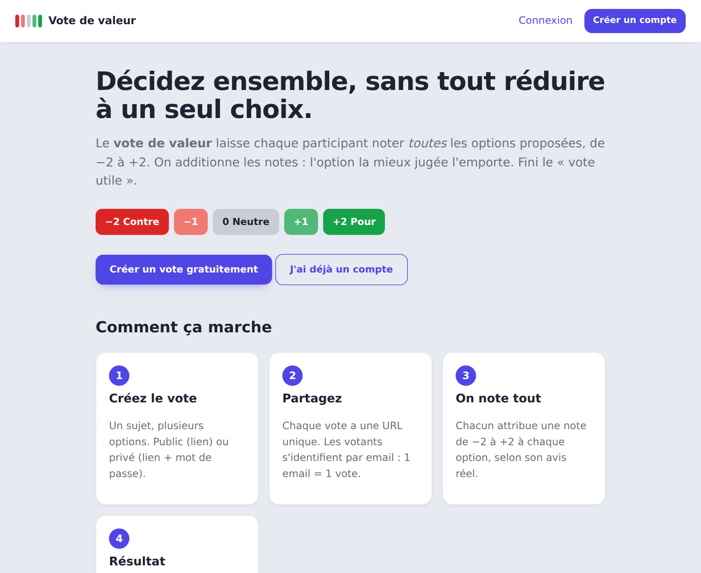
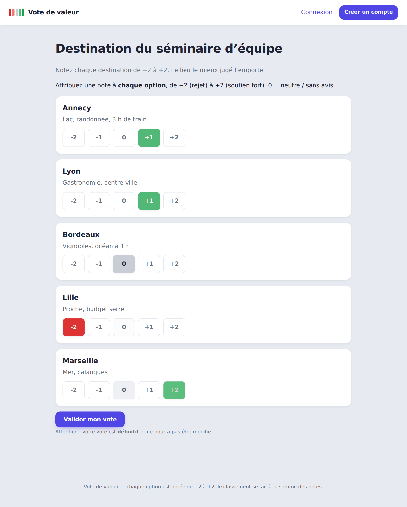

# Vote de valeur — range voting for groups

[](https://github.com/vlebourl/vote-de-valeur/actions/workflows/ci.yml)
[](LICENSE)

*[Version française](README.fr.md)*

A web app to run **range votes** (*vote de valeur*): every voter rates **every** option from **−2 to +2**, and options are ranked by the **sum of their scores**. Instead of picking one favourite, voters express a nuanced opinion on each choice, which removes the "tactical vote" problem of single-choice polls. The interface is in French.

| Landing | Ballot | Live results |
|---|---|---|
|  |  |  |

## Features

- **Organisers** create an account, then polls with text and/or image options, a description and an optional closing date. Title, description and options stay editable after opening.
- **Three ways to identify voters**, chosen per poll:
  - **email magic link** (default): one email = one vote, no account needed;
  - **name only** (lightweight mode for trusted groups): one name = one vote;
  - any poll can also be **private** (link + password).
- **Secret or nominative ballot**: by default nobody, not even the organiser, can link a ballot to a voter. A poll can be switched to nominative, in which case voters are warned on the ballot.
- **Results** are hidden until you have voted (no bandwagon effect), then shown **live** through a personal permanent link, also sent in the confirmation email (which contains no score and no result).
- **Choices added after voting**: a voter can tick "notify me if a choice is added"; when the organiser adds an option and clicks *Notify*, they receive a new personal link to rate only the new choices (their other scores stay final). Without ticking, their results link offers the same. The added scores go into an anonymous supplementary ballot that does not count as an extra voter.
- **Publication threshold**: results stay hidden, for voters and organiser alike, until a poll reaches a minimum number of ballots (5 by default): with one or two ballots, totals would reveal how people voted.
- **Ranking**: sum of scores, abstention counts as 0, ties share the same rank ("1224" ranking).
- **REST API** for organisers (token auth, OpenAPI docs): see below.

## How ballot secrecy works

In a secret poll, no table links a voter to their ballot, and nothing the organiser can see does either:

- the voter's email (or name) is stored only as an **HMAC**, used to enforce one vote per person. Aliases of the same mailbox count as one (`+tag` suffixes everywhere; dots and `googlemail.com` for Gmail);
- the magic-link token is stored only as a **SHA-256 hash**, so a database leak gives access to no ballot;
- a voter who asks to be notified of new choices has their address kept **encrypted with a server key**, in a table linked to their registration and never to their ballot, erased when the poll closes; the organiser only ever sees counts;
- to send the vote confirmation, the email is kept **encrypted with a key derived from the voter's own token** (AES-256-GCM, HKDF). The server can only decrypt it when the voter opens their link to vote, then erases it;
- ballots have **no voter reference and no timestamp**, and the voter's "has voted" date is rounded to the day;
- emails (confirmation, notices) **never contain any score**: a mailbox, including the sender's *Sent* folder, keeps no vote. A vote can be neither changed nor reviewed once cast, and voters confirm this explicitly before submitting;
- results stay hidden below a minimum number of ballots, for the poll and for each choice added along the way.

The [`/donnees`](src/views/donnees.ejs) page explains all of this to voters.

Limits, stated plainly: the HMAC cannot be reversed, but whoever holds the server key can check whether a *given* address took part (not how it voted); this is inherent to detecting duplicates. Someone owning several mailboxes can vote several times. **The server administrator is not protected against**: PostgreSQL stamps every row written by one transaction with the same internal transaction id, and a voter's registration update and ballot are written together; with direct access to the database files, or by watching the server while votes are cast, the host can correlate them. A logical export does not contain these ids, but row order may still hint at the order of votes in a tiny poll, and when choices are added during a poll, the list of choices each voter rated can narrow a supplementary ballot down to a few voters (or one). Protecting against the host would require mixing ballots in batches, which is not implemented. Live results are an aggregate: the publication threshold hides them in very small polls, but once it is reached, two reads around a single new ballot can still reveal that ballot to someone who knows who just voted.

## REST API

Organisers can create and manage polls from scripts. Create a token in the **API** menu (read-only or read-write scope; only its hash is stored, it is shown once), then:

```bash
export VDV_TOKEN=vdv_...
curl -H "Authorization: Bearer $VDV_TOKEN" -H "Content-Type: application/json" \
  -d '{"title":"Team offsite","options":["Annecy","Lyon","Bordeaux"],"close_at":"2026-12-15T18:00:00+01:00"}' \
  https://vote.example.org/api/v1/polls

# email each voter their personal ballot link
curl -H "Authorization: Bearer $VDV_TOKEN" -H "Content-Type: application/json" \
  -d '{"recipients":["alice@example.org","bob@example.org"]}' \
  https://vote.example.org/api/v1/polls/$POLL_ID/invitations

curl -H "Authorization: Bearer $VDV_TOKEN" https://vote.example.org/api/v1/polls/$POLL_ID/results
```

Endpoints: list, create, read, update (title, description, closing date, open/closed, nominative), delete polls; add (JSON or multipart with image), edit, set the image of, and delete options; live results; participants of nominative polls; invitations. Interactive documentation is served at `/api/docs`, and the OpenAPI 3.1 spec at `/api/v1/openapi.json`.

By design, **voting is not exposed**: a voter always votes through their personal link, which keeps "one email, one vote" and ballot secrecy intact. Limits: 600 requests per 15 minutes per token; up to 100 recipients per invitation request and 500 invitations per hour per organiser, all tokens combined (plus a service-wide cap). Someone who has already voted is never re-invited, so their results link stays valid.

## Tech stack

Node.js 22+ · Express 5 · REST API with OpenAPI 3.1 · PostgreSQL (`pg`) · EJS server-side rendering · nodemailer (SMTP) · httpOnly JWT session cookie + bcrypt. No front-end build step: a little vanilla JS for live results.

Security hardening: UUID validation on every route parameter, same-origin check on every write (CSRF), per-IP rate limiting on login, sign-up, magic links and poll passwords, no open redirect, security headers (`Referrer-Policy: same-origin` keeps tokens out of `Referer`), and the app refuses to start in production with missing or weak secrets.

## Run it

### With Docker Compose (app + PostgreSQL)

```bash
npm run init-env          # creates .env with freshly generated secrets (needs Node)
docker compose up --build # http://localhost:3000
```

Migrations run automatically at start-up. With `SMTP_DEV_MODE=true` (the default), no email is sent: magic links are printed in the app logs (`docker compose logs app`).

### Locally

Requires Node ≥ 22 and a PostgreSQL database.

```bash
npm install
npm run init-env   # then set DATABASE_URL in .env
npm run migrate
npm run dev        # http://localhost:3000, restarts on change
```

## Tests

```bash
npm test     # unit + integration tests against a real PostgreSQL
npm run lint
```

`npm test` starts a throwaway embedded PostgreSQL, so nothing needs to be installed. Set `TEST_DATABASE_URL` to use an existing database instead (as the CI does). The suite covers the full voting flow, ballot secrecy at the database level, double-vote races, migration of a pre-existing database, access control, CSRF, open redirects and rate limiting. CI runs lint, tests (Node 22 and 24), `npm audit` and a Docker build on every push.

## Configuration

See [`.env.example`](.env.example). Main variables:

| Variable | Purpose |
|---|---|
| `DATABASE_URL` | PostgreSQL connection string |
| `BASE_URL` | Public URL, used in emailed links |
| `JWT_SECRET`, `EMAIL_HASH_SECRET` | Random secrets, ≥ 32 characters (`openssl rand -hex 32`); required in production |
| `TRUST_PROXY` | Number of reverse proxies in front of the app (e.g. `1` behind Traefik) |
| `APP_TIMEZONE` | Time zone used to display dates (default `Europe/Paris`); closing dates are converted from the browser's time zone |
| `SMTP_HOST`, `SMTP_PORT`, `SMTP_USER`, `SMTP_PASSWORD`, `SMTP_FROM` | Transactional email provider |
| `SMTP_DEV_MODE` | `true` prints emails to the console instead of sending them |

## Deployment

The `Dockerfile` builds a small production image (non-root user, `npm ci`, healthcheck on `/healthz`, which also checks the database). It works on any container host. Notes for [Coolify](https://coolify.io) are in the French README.

## Data model

- `users`: organiser accounts.
- `polls`: title, description, privacy and password hash, nominative flag, identification mode, status, closing date.
- `options`: poll options; images are stored in PostgreSQL, so there is no file volume to manage.
- `poll_voters`: participation (`email_hash`, `token_hash`, encrypted email until the vote, dates), unique per `(poll_id, email_hash)`.
- `ballots` + `ballot_scores`: anonymous ballots and their −2…+2 scores.
- `api_tokens`: organisers' API tokens (hash only, scope, last use, revocation).

## Licence

[MIT](LICENSE) © 2026 Vincent Le Bourlot
